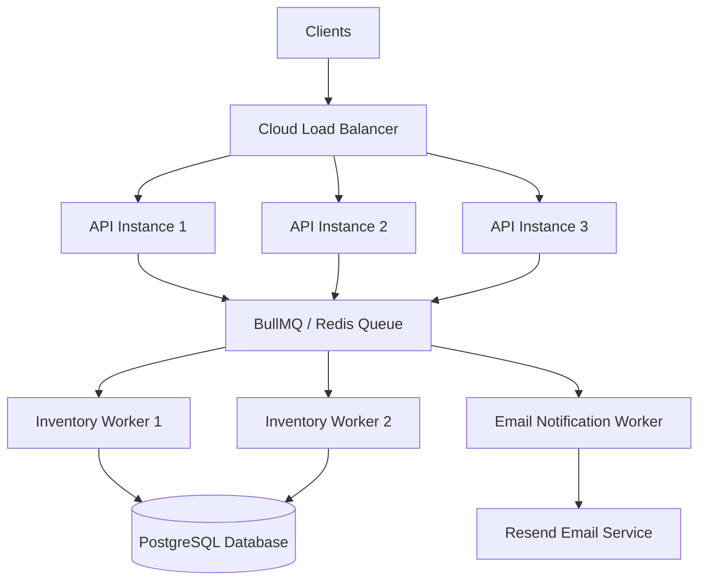

# Event-Driven Order Processing Architecture

## 1. Overview

This architecture uses an event-driven approach to process orders asynchronously. Instead of making the API handle every operation directly, it publishes jobs to a BullMQ queue, allowing background workers to process them independently.

This improves scalability, responsiveness, and fault tolerance.

## 2. Architecture Diagram

## 3. Component Responsibilities

### Cloud Load Balancer

Distributes incoming HTTP requests across multiple API instances to prevent a single server from handling all incoming traffic.

### API Instances

Three independent API instances handle client requests. When an order is created, the API publishes an order-processing job to the BullMQ queue and immediately returns an HTTP `202 Accepted` response.

### BullMQ and Redis

BullMQ manages background jobs using Redis as its underlying data store. It allows API instances to publish jobs and background workers to consume them asynchronously.

### Inventory Workers

Two inventory workers process order-related jobs independently.

Their responsibilities include:

- Retrieving order details.
- Checking product availability.
- Validating available stock.
- Updating inventory quantities in PostgreSQL.
- Updating the order status after processing.

### Email Notification Worker

The email worker handles notification jobs separately from inventory processing. It uses the Resend email service to send notifications, such as order confirmation emails.

### PostgreSQL Database

Stores application data, including orders, products, inventory quantities, and order statuses.

### Resend Email Service

Handles the delivery of email notifications through the Resend API.

## 4. Order Processing Workflow

1. A client sends a `POST /api/orders` request.
2. The load balancer forwards the request to an available API instance.
3. The API validates the request and creates the order.
4. The API publishes an order-processing job to BullMQ.
5. The API responds with `202 Accepted` without waiting for background processing to finish.
6. An available inventory worker consumes the job and processes the order against PostgreSQL.
7. Once the order is successfully processed, an email notification job can be added to the queue.
8. The email worker consumes the notification job and sends the email through Resend.

## 5. Scalability

The architecture supports horizontal scaling at different levels:

- **API scaling:** Additional API instances can be introduced behind the load balancer to handle increased HTTP traffic.
- **Worker scaling:** Additional inventory or email workers can be started independently to handle increased background-processing workloads.
- **Queue-based processing:** BullMQ distributes available jobs among active workers, preventing the API from being blocked by time-consuming operations.

For example, if order volume increases, more inventory workers can be deployed without necessarily increasing the number of API instances.

## 6. Fault Tolerance

BullMQ supports retry mechanisms for failed jobs using configurable attempts and exponential backoff.

Jobs that exhaust their retry attempts can be moved to a Dead Letter Queue (DLQ) for investigation and possible reprocessing.

This helps prevent temporary service failures from permanently interrupting background processing.

---

**Architecture Summary:** The cloud load balancer distributes incoming API traffic, BullMQ and Redis coordinate asynchronous job processing, inventory workers communicate with PostgreSQL, and the email worker communicates with Resend. Each component can scale independently according to its workload.
